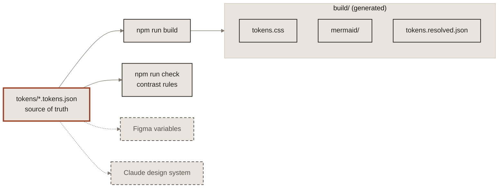

# mise-en-place

> My personal design system: one source of truth for how my docs, diagrams, slides and carousels look and read.

*Mise en place* is the kitchen habit of having everything prepped and in its place before you cook. A design system does the same for design: the choices are made once, so each new page, slide or diagram starts ready.

The style is minimal, editorial and typography-led: warm grey paper, near-black ink, one terracotta accent, square corners, and accessible contrast in every theme.

**Status:** v0.1.1, prototype scale (see [Scale](#scale)).

## Use it

| You want to... | Use |
|---|---|
| Style a web page or HTML doc | [`build/tokens.css`](build/tokens.css), then `var(--mep-color-text-default)` and friends |
| Draw a Mermaid diagram on GitHub | [`build/mermaid/starter.mmd`](build/mermaid/starter.mmd) and [guidelines/diagrams.md](guidelines/diagrams.md) |
| Read values from a script or tool | [`build/tokens.resolved.json`](build/tokens.resolved.json) (flat, plain values) |
| Import into Figma or a token tool | [`tokens/`](tokens) (W3C DTCG format) |
| Brief an AI assistant | Point it at [`AGENTS.md`](AGENTS.md) |
| Write in my voice | [guidelines/writing.md](guidelines/writing.md) |

Pin a version when you depend on it, for example `https://raw.githubusercontent.com/miguelmog10/mise-en-place/v0.1.0/build/tokens.css`.

## How it works



Solid boxes exist today. Dashed boxes are planned.

## Repository map

```
tokens/            Source of truth (W3C DTCG format). Edit here.
  primitives       Tier 1: raw colors. Never used directly.
  themes/          Tier 2: light, dark, paper. Same names, different values.
  foundations      Type, spacing, lines. Theme-independent.
build/             Generated by npm run build. Never edit by hand.
scripts/           Build, check and GitHub setup scripts. Node 20+, no dependencies.
guidelines/        How to use the tokens: foundations, diagrams, writing, formats.
docs/decisions/    Why things are the way they are (ADRs).
dev/               How we build it: status, backlog (the Later list), repo setup, tool feedback.
assets/            Fonts and icons (empty for now).
AGENTS.md          One-page brief for AI assistants.
```

## Change it

Get a copy first (needs git and Node 20+):

```
git clone https://github.com/miguelmog10/mise-en-place.git
cd mise-en-place
npm run verify
```

Then:

1. Edit a file in `tokens/` (or a guideline).
2. Run `npm run verify` (builds `build/` and checks contrast). Commit `build/` with your change.
3. If it is a decision, add an ADR in `docs/decisions/`.
4. Add a line to `CHANGELOG.md`.

CI rebuilds on every push and fails if `build/` is out of date or a contrast rule fails.

## Versioning

[Semantic versioning](https://semver.org), tagged as `vX.Y.Z`:

- **Major:** a token is renamed or removed, or a rule changes meaning. Consumers may break.
- **Minor:** new tokens, themes, guidelines or outputs. Nothing existing changes.
- **Patch:** value refinements that keep every rule passing, and doc fixes.

While the version is `0.x`, anything can still change. Pin a tag.

## Scale

Following [Scale Deliberately](https://github.com/miguelmog10/ai-assisted-software-engineering/blob/main/PRINCIPLES.md#scale-deliberately), this repo runs at **prototype** scale. Non-negotiables:

- One source of truth (`tokens/`); everything else is generated.
- Every text color passes WCAG AA, checked by script, not by eye.
- Decisions are recorded as short ADRs.
- Deferred work lives in the [Later list](dev/backlog.md), not in anyone's head.

## License

[MIT](LICENSE). The fonts it names (Lora, Inter) are under the SIL Open Font License 1.1 and are not included yet.

## Author's note

The design judgment, the carousel this grew from and the decisions are mine. Claude helped extract the values, structure the repo, write the build and pressure-test the choices, which is the workflow described in my [AI-Assisted Software Engineering principles](https://github.com/miguelmog10/ai-assisted-software-engineering).
