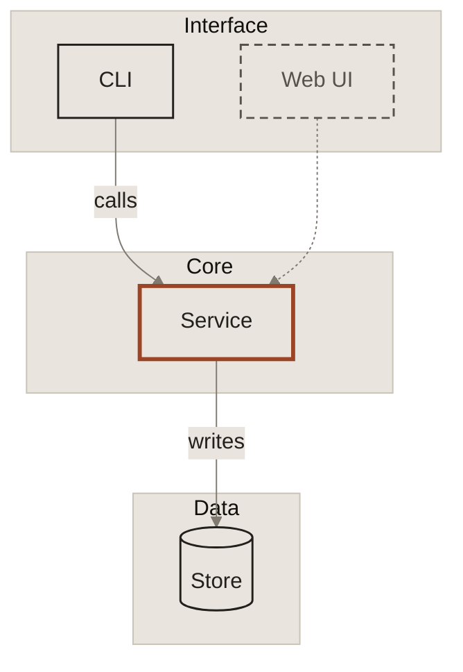

# Diagrams

Architecture and flow diagrams, mostly Mermaid in GitHub Markdown. First consumer: Knowledge Automata.

## Start from the starter

Copy [`build/mermaid/starter.mmd`](../build/mermaid/starter.mmd) into a ` ```mermaid ` block. Keep the frontmatter and the `classDef` lines; replace the example.

Why the paper theme and system fonts: GitHub draws Mermaid on white or dark depending on the reader, cannot load Lora or Inter, and the diagram cannot follow the reader's theme. Paper fills behind every label keep text readable on any background ([ADR 0004](../docs/decisions/0004-mermaid-on-github.md)).

## Vocabulary

| Meaning | How | Class |
|---|---|---|
| Built: exists today | Solid ink border, ink text | `:::built` |
| Planned: not built yet | Dashed subtle border, subtle text | `:::planned` |
| Focus: the thing this diagram is about | Thick accent border | `:::focus` |
| Layer or boundary | `subgraph` with paper fill and hairline border | (default) |
| Flow of data or control | Solid arrow `-->` | |
| Planned or optional flow | Dotted arrow `-.->` | |

Every meaning is carried by line style as well as color, so the diagram still reads in grayscale.

## Rules

- **One focus per diagram**, at most. If everything is accent, nothing is.
- **Label edges only when the arrow is not obvious.** Keep labels to two or three words.
- **Name boxes as nouns** ("Governor", "Decision log"), edges as verbs ("routes", "writes").
- **Layers top to bottom** (`flowchart TB`) for architecture; **left to right** (`flowchart LR`) for pipelines and sequences of steps.
- **Square corners:** use `["..."]` nodes. Use `[("...")]` only for data stores.
- **Prefer flowcharts.** Sequence diagrams draw message labels straight on the host background, where they cannot reach 4.5:1 on both white and dark. Until that is solved, keep sequence diagrams short and their labels large, or use a flowchart.
- **Under about 12 boxes.** Split bigger systems into one overview plus one diagram per layer.

## Example



## Outside GitHub

On a page that loads `build/tokens.css`, you can use the page's own theme instead. On a fixed image (carousel, slide), follow the one diagram drawn so far: shapes defined by a 6px accent top edge and the 8% highlight fill, labels in `text.subtle` inside, no outlines or connectors unless they carry meaning. Rules for connectors on canvas are not defined yet.
