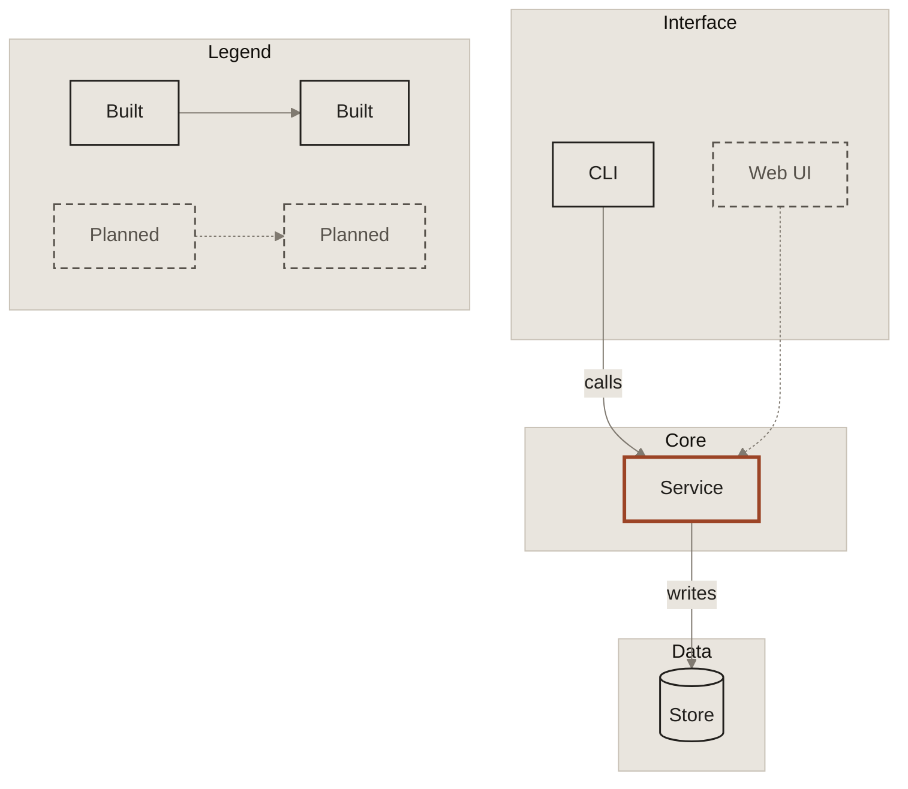

# Diagrams

Architecture and flow diagrams: Mermaid in GitHub Markdown, and the same diagrams styled on screens. First consumer: Knowledge Automata. The vocabulary is shared by both theme families ([foundations.md](foundations.md#status-vocabulary)).

## Pick the output

| Where the diagram lives | Use | Theme |
|---|---|---|
| GitHub Markdown, any Markdown host | [`build/mermaid/starter.mmd`](../build/mermaid/starter.mmd), [`sequence-starter.mmd`](../build/mermaid/sequence-starter.mmd) | Editorial paper, system fonts |
| A page that renders Mermaid in the browser | [`theme-screen-light.json`](../build/mermaid/theme-screen-light.json), [`theme-screen-dark.json`](../build/mermaid/theme-screen-dark.json) | Screen light and dark |
| A diagram built in HTML and CSS | `build/tokens.css` with `data-family="screen"` | Screen |

Markdown files keep plain Mermaid on paper. Where a styled version exists on the website, link to it under the diagram.

## Start from the starter

Copy [`build/mermaid/starter.mmd`](../build/mermaid/starter.mmd) into a ` ```mermaid ` block. Keep the frontmatter and the `classDef` lines; replace the example, and keep the legend if the diagram shows more than one status.

Why paper and system fonts on GitHub: GitHub draws Mermaid on white or dark depending on the reader, cannot load custom fonts, and the diagram cannot follow the reader's theme. Paper fills behind every label keep text readable on any background ([ADR 0004](../docs/decisions/0004-mermaid-on-github.md)).

## Vocabulary

| Meaning | How | Class |
|---|---|---|
| Built: exists today | Solid ink border, ink text | `:::built` |
| Planned: not built yet | Dashed border, subtle text | `:::planned` |
| Focus: the thing this diagram is about | Accent (see below) | `:::focus` |
| Data store | Cylinder in Mermaid; on screens, a square box with a 4px double bottom border | `[("...")]` |
| Layer or boundary | `subgraph` with background fill and hairline border | (default) |
| Flow of data or control | Solid arrow `-->` | |
| Planned or optional flow | Dotted arrow `-.->` | |

Every meaning is carried by line style as well as color, so the diagram still reads in grayscale.

**Focus by family.** Editorial and all Mermaid output: a 3px accent border. Screen diagrams built in HTML and CSS: a 6px accent top edge (`border.width.edge`) on the one focused box, which Mermaid cannot draw.

## Legend

Every diagram with more than one status shows a legend: a solid box is built, a dashed box is planned, a solid arrow is a built flow, a dotted arrow a planned flow. In Mermaid, a `Legend` subgraph with two pairs of example nodes:

```
subgraph legend["Legend"]
  direction LR
  lb1["Built"]:::built --> lb2["Built"]:::built
  lp1["Planned"]:::planned -.-> lp2["Planned"]:::planned
end
```

## Rules

- **One focus per diagram**, at most. If everything is accent, nothing is.
- **Label edges only when the arrow is not obvious.** Keep labels to two or three words.
- **Name boxes as nouns** ("Governor", "Decision log"), edges as verbs ("routes", "writes").
- **Layers top to bottom** (`flowchart TB`) for architecture; **left to right** (`flowchart LR`) for pipelines and sequences of steps.
- **Square corners:** use `["..."]` nodes. Use `[("...")]` only for data stores.
- **Under about 12 boxes.** Split bigger systems into one overview plus one diagram per layer.
- **Under about 1,200px wide** on GitHub (see limits below).

## Sequence diagrams

Sequence diagrams draw message text on the host page, where no single color reaches 4.5:1 on both white and dark. Start from [`build/mermaid/sequence-starter.mmd`](../build/mermaid/sequence-starter.mmd), which follows three habits ([ADR 0011](../docs/decisions/0011-diagram-legend-and-sequence-pattern.md)):

1. **Wrap every message in a paper rect,** `rect rgb(233, 229, 222)`, so message text sits on paper, not on the host background.
2. **Message and loop text in ink** (`signalTextColor` and `loopTextColor` set to `text.default`): 12.9:1 on paper.
3. **`participant`, never `actor`.** An actor's name is drawn on the host background and disappears on GitHub dark.

Lifelines outside the rect stay on the host page; they use `diagram.line`, which keeps 3:1 on white and both GitHub dark themes.

## Screen themes for Mermaid

A page that renders Mermaid in the browser can swap a diagram's skin without touching its content. Each `theme-screen-*.json` holds:

- `theme`, `fontFamily`, `themeVariables`: the Mermaid config, for `mermaid.initialize()` or a frontmatter block.
- `frontmatter`: the same config as a ready `---` block.
- `classDefs`: the `built`, `planned` and `focus` lines.

To reskin, replace the diagram's frontmatter with `frontmatter` and each `classDef built|planned|focus` line with the matching entry in `classDefs`. Pick the file by the page's theme, and swap again when it changes. On screens, boxes are ticket paper on tile, and planned outlines use `border.strong`.

## Known limits on GitHub

Observed on github.com with the v0.1.0 README diagram. These cannot be fixed from the diagram:

- **Shadows.** GitHub adds a drop shadow to every node, against the "no shadows" rule.
- **Fonts and themes.** GitHub cannot load custom fonts and cannot switch a diagram between light and dark. Mermaid on GitHub stays paper with system fonts, which is why the starters use them.
- **Width.** Wide diagrams are scaled down to the page column (about 900px). Keep GitHub diagrams under about 1,200px wide, or split them.
- **Rounded shapes.** Mermaid draws cylinders and sequence participants with rounded parts. Keep cylinders for data stores only.

## Example



## On canvas

On a fixed image (carousel, slide), follow the one diagram drawn so far: shapes defined by a 6px accent top edge and the 8% highlight fill, labels in `text.subtle` inside, no outlines or connectors unless they carry meaning. Rules for connectors on canvas are not defined yet.
